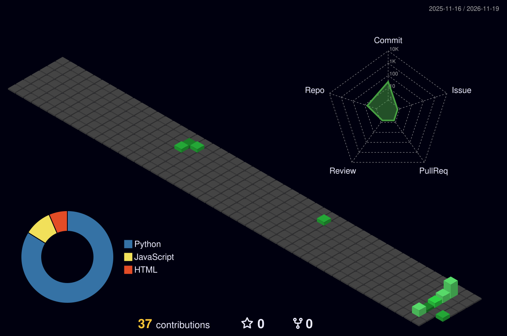

# Hi, I'm Nikos 👋

Third-year student at the Department of Digital Industry Technologies (NKUA), Athens. I build Android and web apps, contribute to open source, and I'm writing my thesis on explainable AI. Outside university I run a small video editing business and build and repair PCs.

## ⭐ Highlights

<table>
<tr>
<td width="72" align="center">💧</td>
<td>
<a href="https://github.com/Nikpar005/glou-app"><b>Glou: water tracker for Android</b></a> 
My own Android app: a personal daily goal from weight and activity, reminders with a "Drank 250 ml" button that works without opening the app, and Glou, a mascot that dresses for the local weather and talks in lines from Greek mythology. 
React · Capacitor · Java (native Android) · Vitest · GitHub Actions 

</td>
</tr>
<tr>
<td align="center">🎮</td>
<td>
<a href="https://github.com/boykopovar/AnyPS5"><b>AnyPS5</b></a> (open-source contributor) 
Runs PS5 executables natively on Linux and Windows. I test the relinker on Windows, fix what I find, and review other contributors' pull requests. Two of my reviews caught real bugs that were fixed before the code was merged. 
C++ · CMake · Python · Windows internals 

</td>
</tr>
<tr>
<td align="center">💎</td>
<td>
<a href="https://github.com/Nikpar005/glowst-eshop"><b>Glowst</b></a> 
A full-stack e-shop demo with Stripe payments and an admin panel with JWT authentication. 
FastAPI · React · Vite · SQLAlchemy · SQLite · Stripe
</td>
</tr>
</table>

## More projects

<table>
<tr>
<td width="72" align="center">🎬</td>
<td>
<a href="https://github.com/Nikpar005/Watchlist-App"><b>Watchlist App</b></a> 
Keeps a list of films and series, with details fetched from the OMDb API. 
FastAPI · SQLAlchemy · Pydantic · SQLite · JavaScript
</td>
</tr>
<tr>
<td align="center">🌦️</td>
<td>
<b>Home weather station</b> 
Temperature and humidity from ESP boards with DHT11 sensors, one on battery on the balcony, with history on ThingSpeak and Raspberry Pi Zero W displays. 
ESP8266 · Raspberry Pi · IoT
</td>
</tr>
<tr>
<td align="center">🤖</td>
<td>
<b>Arduino obstacle-avoiding robot</b> 
A four-motor robot I built in high school, now getting a better avoidance algorithm and a camera. 
Arduino · C++
</td>
</tr>
<tr>
<td align="center">🧠</td>
<td>
<b>Thesis: SHAP vs. LIME</b> 
A comparative study of two explainable AI methods. 
Python · Machine learning
</td>
</tr>
</table>

## Tools

## Stats

